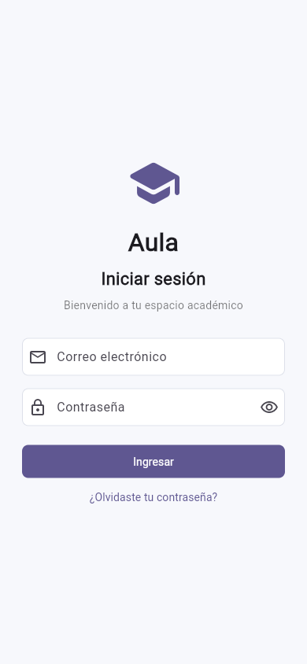
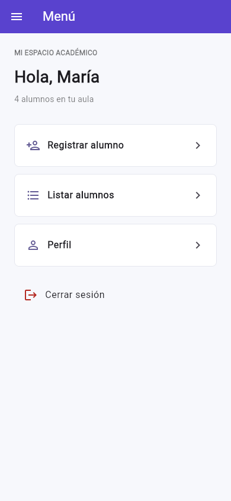
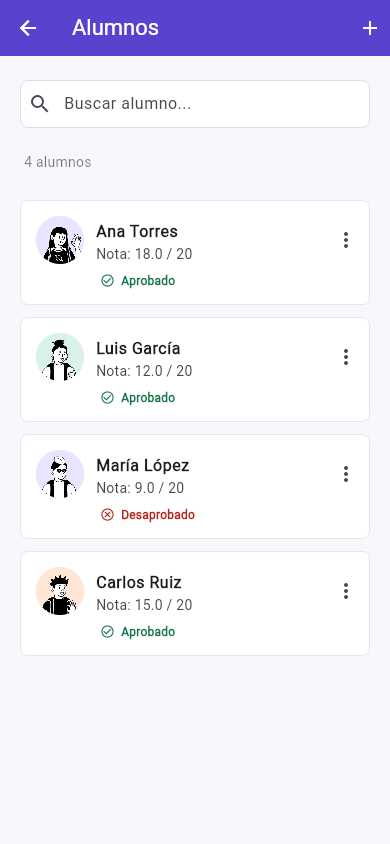
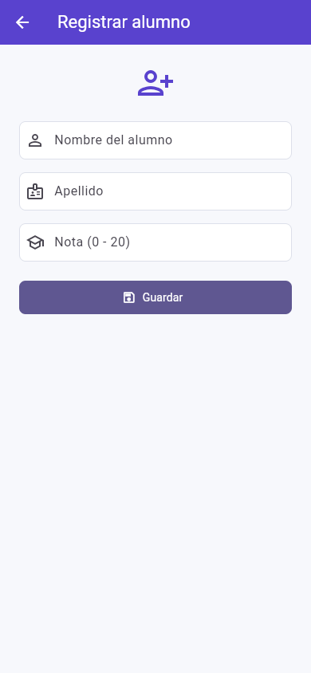
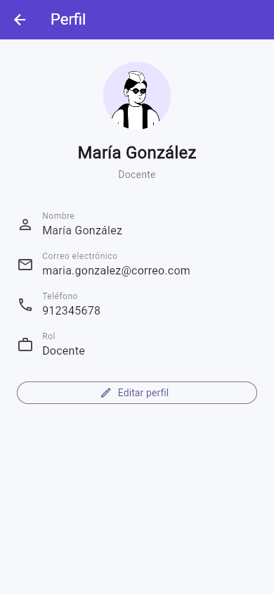

# Aula | Gestión de alumnos

Práctica de Aplicaciones Móviles Multiplataforma, semanas 7 y 8, Tecsup.
Aplicación Flutter con cinco pantallas basada en la referencia del laboratorio.

**Repositorio:** [C5-PHO/AMM-S8](https://github.com/C5-PHO/AMM-S8)

## Ejecución

Probado con Flutter 3.35.3 y Dart 3.9.2. Se necesita un SDK Flutter con Dart 3.9.2 o compatible con `^3.9.2`, Chrome o un dispositivo Android configurado.

```sh
git clone https://github.com/C5-PHO/AMM-S8.git
cd AMM-S8
flutter pub get
flutter run -d chrome
```

El proyecto Flutter está en la raíz del repositorio. Para Android, ejecutar `flutter devices` y luego `flutter run -d ID_DEL_DISPOSITIVO`.

Acceso de prueba: `demo@aula.pe` y `demo123`. También se acepta cualquier correo con formato válido y una contraseña de 6 caracteres o más. El acceso es simulado; no hay autenticación real ni envío de credenciales.

## Pantallas y funciones

1. **Login:** validación de campos, contraseña visible/oculta y ayuda de acceso.
2. **Menú:** accesos a registro, listado y perfil; menú lateral y cierre de sesión.
3. **Alumnos:** cuatro alumnos iniciales, búsqueda por nombre/apellido, edición y eliminación con confirmación.
4. **Registrar alumno:** nombre, apellido y nota entre 0 y 20; admite coma o punto decimal.
5. **Perfil:** datos del docente y diálogo para editar nombre, correo y teléfono.

El estado se comparte durante la ejecución. Los alumnos y el perfil se reinician al recargar o cerrar la aplicación; no se usa base de datos ni almacenamiento persistente. Cerrar sesión elimina el historial de navegación, pero conserva los datos de esta ejecución.

Regla de evaluación de esta práctica: aprobado desde **11/20**.

## Capacidades del laboratorio

| Elemento | Implementación |
| --- | --- |
| ListViews | Menú desplazable, listado dinámico con `ListView.builder` y formularios desplazables. |
| ListTiles | Opciones del menú, filas de alumnos y datos del perfil. |
| Listas y mapas | `List<Map<String, dynamic>>` para alumnos y `Map<String, String>` para perfil. |
| Rutas | Rutas nombradas en `MaterialApp`, navegación de ida/vuelta y limpieza del historial al salir. |
| Tema global | Colores, AppBar, campos, botones y tarjetas definidos en `main.dart`. |
| Cards | Tarjetas de opciones y de alumnos con avatar, nota y estado. |

## Organización

```text
lib/
  main.dart                    # Aplicación, rutas y tema global
  data/datos_academicos.dart    # Lista de alumnos, mapa del perfil y regla de nota
  screens/                     # Login, menú, alumnos, registro y perfil
  widgets/contenido.dart       # Ancho adaptable, avatar local y cierre de sesión
assets/images/                 # Avatares PNG incluidos en el proyecto
test/widget_test.dart           # Pruebas de los recorridos principales
docs/                          # Conceptos complementarios y capturas
```

## Imágenes locales

Las cuatro imágenes están en `assets/images/`, declaradas en `pubspec.yaml` y cargadas con `AssetImage`. La app no consulta una API de imágenes durante su uso.

Los avatares provienen de [Notionists de Zoish, vía DiceBear](https://www.dicebear.com/styles/notionists/), licencia [CC0 1.0](https://creativecommons.org/publicdomain/zero/1.0/). Ver [procedencia y archivos](assets/images/README.md).

## Conceptos complementarios

Se revisaron los apuntes de navegación de Semana 07 y del calendario de Semanas 05-06. Los comentarios explican recursos complementarios a esos apuntes, sin asumir que representan todo lo visto en clase: validación con `Form`, controladores, filtrado con `where`, operaciones asíncronas, `mounted` y diálogos. Ver [explicación para clase](docs/CONCEPTOS.md).

## Verificación

```sh
flutter analyze
flutter test
flutter build web
```

Las pruebas cubren acceso, salida, validación de notas, registro, búsqueda, edición, confirmación de eliminación, edición de perfil y navegación en un ancho de 320 píxeles.

## Capturas

| Login | Menú | Alumnos |
| --- | --- | --- |
|  |  |  |

| Registro | Perfil |
| --- | --- |
|  |  |
